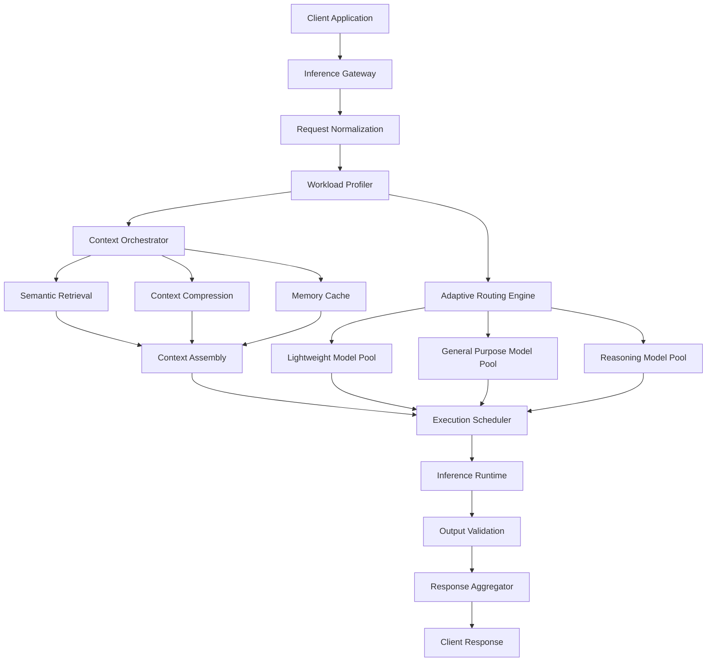

# LatentMesh
### Modular Infrastructure for Adaptive Large Language Model Inference

**Experimental AI Systems Architecture | Distributed Inference | Context Orchestration | Model Routing**

---

## Abstract

LatentMesh is an experimental systems architecture exploring how large language model inference can be separated into modular, independently optimizable computational stages.

Contemporary language model deployment relies heavily on monolithic inference pipelines in which model execution, context management, memory retrieval, routing, and output generation are tightly coupled.

Although effective for individual model deployments, such architectures can introduce unnecessary computational overhead when applied to heterogeneous workloads, multi-model systems, or long-context reasoning applications.

LatentMesh investigates an alternative approach: a modular inference orchestration layer designed to coordinate language model execution through adaptive routing, semantic context management, workload classification, and inference-aware scheduling.

The central hypothesis is that language model inference efficiency can be improved not only through optimization of the underlying neural network, but also through optimization of the systems surrounding model execution.

Rather than treating each request as an isolated sequence generation task, LatentMesh conceptualizes inference as a sequence of computational decisions that can be evaluated, scheduled, cached, and routed independently.

This repository documents the proposed architecture, theoretical foundations, component specifications, and future experimental methodology.

> **Project status:** LatentMesh is currently an architectural research concept. The interfaces, algorithms, and performance characteristics discussed below are proposed designs and have not been validated through an implemented inference engine.

---

# 1. Introduction

Large language models have evolved from standalone sequence prediction systems into foundational computational components supporting agentic workflows, retrieval-augmented generation, autonomous software systems, and distributed AI applications.

This transition introduces a growing set of systems-level challenges.

An inference request may require several independent operations:

- Input normalization and tokenization
- Context retrieval and assembly
- Model capability selection
- Compute resource allocation
- Attention cache management
- Sequence generation
- Output verification
- Tool execution
- State persistence

Traditional deployment architectures frequently combine many of these operations into a single execution pipeline.

LatentMesh proposes a framework in which these responsibilities are separated into distinct computational modules communicating through a shared inference orchestration protocol.

The proposed architecture aims to support environments where inference workloads exhibit significant variation in complexity, latency sensitivity, context length, and required reasoning capabilities.

## 1.1 Motivation

Not all language model requests require equivalent computational resources.

A short classification request, for example, differs substantially from a long-context reasoning task involving multiple external information sources.

Nevertheless, many deployment systems assign inference resources based primarily on model availability rather than workload-specific computational characteristics.

This can lead to inefficient resource allocation.

LatentMesh explores whether workload-aware scheduling and model selection can reduce unnecessary compute while preserving task quality.

The system is motivated by four observations:

**Observation I — Inference workloads are heterogeneous.**

Language model applications contain requests with different latency, reasoning, and memory requirements.

**Observation II — Context is an independent computational resource.**

Context retrieval, compression, persistence, and reuse can significantly influence inference efficiency.

**Observation III — Model capability is not uniformly required.**

Different requests may be adequately handled by models with different parameter counts, architectures, or specializations.

**Observation IV — Inference systems benefit from explicit orchestration.**

Separating execution planning from model generation may enable more efficient use of heterogeneous infrastructure.

---

# 2. Architectural Overview

LatentMesh is organized around a collection of logical subsystems responsible for coordinating inference requests.

The architecture contains five major layers:

1. Request processing
2. Workload analysis
3. Context orchestration
4. Adaptive model execution
5. Response validation

Each layer is designed to operate independently while participating in a shared inference lifecycle.

---

# 3. Design Philosophy

LatentMesh follows a set of architectural principles intended to preserve modularity and extensibility.

## 3.1 Separation of Execution and Orchestration

The model runtime should not determine how an inference request is routed or scheduled.

Instead, an external orchestration layer evaluates the request and constructs an execution plan.

This separation enables experimentation with routing strategies without requiring changes to the underlying model runtime.

## 3.2 Model-Agnostic Interfaces

LatentMesh is designed conceptually to support multiple inference backends.

Potential integrations include:

- Hugging Face Transformers
