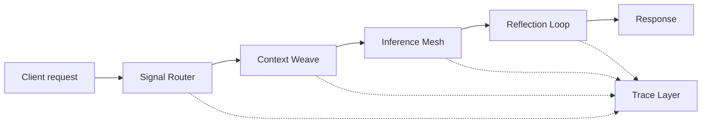

<div align="center">

# ◈ LatentMesh
### A modular inference fabric for adaptive language-model systems

**Context routing · Memory orchestration · Model-aware execution · Observability**

  

*A design exploration of how language-model workloads could be coordinated across specialized reasoning layers.*

</div>

---

## Overview

LatentMesh is a **concept-stage architecture proposal** for building modular LLM pipelines. It explores a simple question: *what if prompt processing, retrieval, model selection, and response evaluation were independent components connected by a shared execution layer?*

The idea is to treat inference as a graph rather than a single request/response endpoint. Individual stages can transform context, suggest a routing strategy, or annotate the result with evaluation metadata.

> **Project status:** Concept / documentation only. This repository does not contain a functioning LLM, inference server, benchmark implementation, or production-ready framework.

## Core concepts

| Layer | Proposed responsibility |
| --- | --- |
| **Signal Router** | Classify task shape and choose a hypothetical execution path |
| **Context Weave** | Combine short-term conversation context and retrieved knowledge |
| **Inference Mesh** | Define interfaces for model backends and routing policies |
| **Reflection Loop** | Sketch how a second-pass output check might work |
| **Trace Layer** | Specify observability metadata for each conceptual pipeline stage |

## Architectural sketch



## Example hypothetical pipeline

```yaml
pipeline:
  name: adaptive-response
  mode: design-only
  stages:
    - signal_router
    - context_weave
    - inference_mesh
    - reflection_loop
  policies:
    routing: task-aware
    context_budget: dynamic
    trace_level: structured
```

This configuration is **illustrative only**; it is not parsed or executed by any code in this repository.

## Design principles

- **Composable execution:** Keep orchestration stages independent and interchangeable.
- **Explicit context budgets:** Make prompt-context allocation a configurable decision.
- **Backend agnosticism:** Describe interfaces without assuming a particular model provider.
- **Observable by design:** Define where timing, token usage, and error metadata would be collected.
- **Controlled iteration:** Separate speculative response refinement from live production behavior.

## Proposed directory structure

```text
latentmesh/
├── README.md
├── LICENSE
├── docs/
│   ├── architecture.md
│   └── roadmap.md
└── examples/
    └── pipeline.yaml
```

## Current scope

This repository currently provides an architectural overview, an illustrative YAML pipeline definition, and a phased roadmap. It intentionally does **not** claim model performance, speedups, benchmark scores, customers, integrations, or implemented capabilities.

## Potential applications

Research assistants, multi-model experiments, retrieval-augmented generation workflows, and agent orchestration are possible future directions—not current features.

## Contributing

Ideas, design critiques, and architecture discussions are welcome. Any future implementation should include reproducible tests and clearly labeled benchmarks before performance claims are made.

## License

MIT. See [LICENSE](LICENSE).
